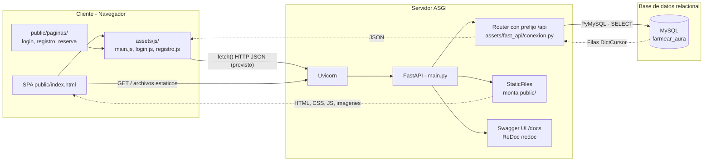
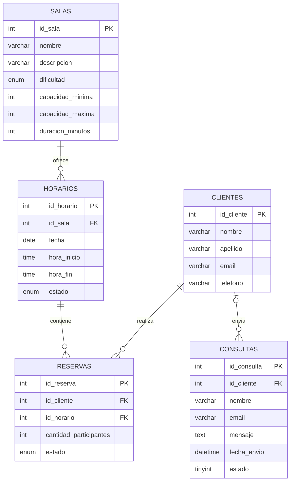
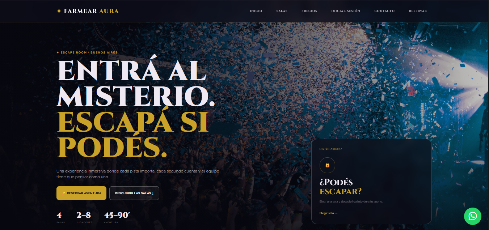
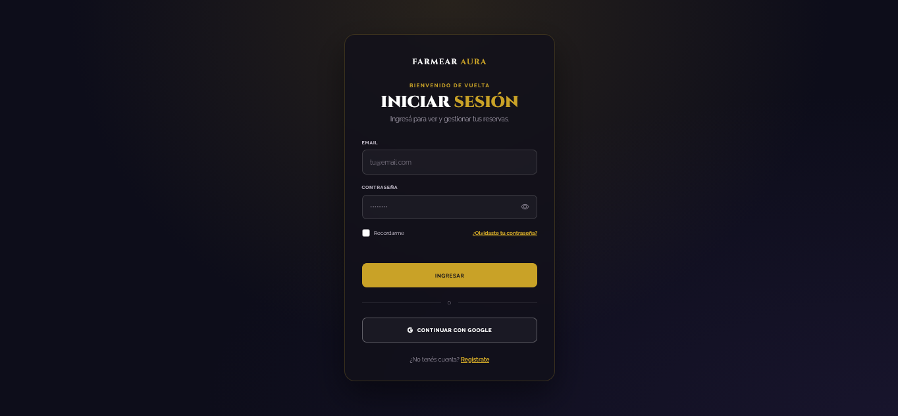

<div align="center">

# FARMEAR AURA — Escape Room (Buenos Aires)

**Sitio Web Full Stack para un centro de Escape Rooms: SPA en el frontend, API REST con FastAPI y base de datos relacional MySQL.**

<br />


<br />

*Trabajo práctico integral — Seminario de Actualización en Tecnología Web · **IFTS N.º 21***

`[ACTIVO EN DEVELOP]`

</div>

---

## Tabla de Contenidos

1. [Resumen Ejecutivo](#1-resumen-ejecutivo)
2. [Estado Real del Proyecto](#2-estado-real-del-proyecto)
3. [Arquitectura del Sistema](#3-arquitectura-del-sistema)
4. [Frontend](#4-frontend)
5. [Backend](#5-backend)
6. [Base de Datos](#6-base-de-datos)
7. [Estructura de Directorios](#7-estructura-de-directorios)
8. [Instalación y Ejecución Local](#8-instalación-y-ejecución-local)
9. [Galería Visual](#9-galería-visual)
10. [Observaciones Técnicas y Roadmap](#10-observaciones-técnicas-y-roadmap)
11. [Equipo y Créditos](#11-equipo-y-créditos)
12. [Licencia](#12-licencia)

---

## 1. Resumen Ejecutivo

**Farmear Aura** es el sitio web de un centro de **Escape Rooms en Buenos Aires** con cuatro salas temáticas, tarifas, reservas, módulos de acceso de usuarios y un canal de contacto, dentro de una estética oscura, dorada y enigmática.

El repositorio evolucionó desde un prototipo web estático hacia una aplicación Full Stack. La rama `develop` integra el trabajo de `feature/base-de-datos-api`: un backend en FastAPI, un esquema relacional MySQL y un frontend que se sirve desde el mismo servidor.

| Dimensión | Descripción |
|---|---|
| **Frontend** | SPA en `public/` con HTML5, Bootstrap 5.3 y estilos propios con prefijo `.fa-*`. |
| **Backend** | Python 3, FastAPI y Uvicorn; sirve la API bajo `/api` y los archivos estáticos de `public/`. |
| **Datos** | MySQL 8.x, base `farmear_aura`, con 5 tablas relacionales y datos iniciales. |

---

## 2. Estado Real del Proyecto

Esta tabla refleja el contenido verificable de la rama `develop`.

Referencia de estados:  

| Componente | Estado | Detalle |
|---|---|---|
| SPA `public/index.html` |  | Navbar, hero, salas, precios, contacto, WhatsApp, footer. |
| Estilos `.fa-*` + Bootstrap 5.3 |  | `styles.css`, `login.css`, `registro.css`, `reserva.css`. |
| Navegación activa con `IntersectionObserver` |  | `assets/js/main.js`. |
| Pestañas de tarifas |  | Muestra y oculta tarjetas de precio desde `main.js`. |
| Pop-up de reserva (`popover` + `iframe`) |  | Carga `paginas/reserva.html`. |
| Páginas de login, registro y reserva (interfaz y validación en cliente) |  | `public/paginas/`. |
| Servidor FastAPI + `StaticFiles` |  | `main.py`. |
| Endpoint `GET /api/salas` |  | Consulta la tabla `salas` con PyMySQL. |
| Esquema SQL y datos iniciales |  | Script `.sql` (volcado de HeidiSQL, MySQL 8.4.3). |

---

## 3. Arquitectura del Sistema

El navegador carga la SPA desde FastAPI, que monta `public/` como archivos estáticos. La API vive bajo el prefijo `/api` y consulta MySQL mediante PyMySQL.



### Principios de diseño

▸ **Montaje estático al final:** `StaticFiles` se registra después de los routers para no interceptar `/api/*`.

▸ **Routers modulares:** cada dominio se expone con un `APIRouter` incluido en `main.py` con el prefijo `/api`.

▸ **Contrato JSON:** FastAPI serializa automáticamente las filas devueltas por la capa de datos.

---

## 4. Frontend

Directorio: `public/` — 

### 4.1 Páginas

| Archivo | Descripción |
|---|---|
| `public/index.html` | SPA principal con navegación por anclas. |
| `public/paginas/login.html` | Inicio de sesión: email, contraseña con botón mostrar/ocultar, "Recordarme" y botón "Continuar con Google" (solo interfaz). |
| `public/paginas/registro.html` | Alta de cuenta: nombre, apellido, usuario, email, contraseña doble con indicador de fuerza y aceptación de términos. |
| `public/paginas/reserva.html` | Reserva en tres pasos: sala, fecha/horario/personas y datos de contacto, con resumen dinámico. Se muestra dentro de un pop-up en `index.html`. |

### 4.2 Secciones de `index.html`

| Sección | Selector | Contenido |
|---|---|---|
| Navbar | `nav.fa-navbar` | Barra `fixed-top` con *glassmorphism* (`backdrop-filter: blur(14px)`), logotipo `FARMEAR AURA` en Cinzel y menú hamburguesa de Bootstrap. Enlaces: Inicio, Salas, Precios, Iniciar sesión (`paginas/login.html`), Contacto y botón **Reservar**, que abre el pop-up. |
| Pop-up de reserva | `#popup-dinamico` | Elemento `popover` nativo de HTML con un `iframe` hacia `paginas/reserva.html`. |
| Hero | `section#inicio` | Imagen de fondo con zoom animado, *overlay* de doble gradiente, llamados a la acción, métricas (4 salas, 2–8 jugadores, 45–90') y tarjeta "Misión Abierta" visible solo en escritorio (`d-none d-lg-block`). |
| Salas | `section#salas` | Grilla `row g-3` con `col-lg-3 col-md-6`: 4 tarjetas `.fa-room` con imagen de fondo, dificultad, sinopsis, capacidad y duración. |
| Precios | `section#precios` | Tres botones (`.fa-price-tab`) que despliegan una tarjeta de tarifa a la vez. |
| Contacto | `section#contacto` | Datos de contacto, formulario `#contactForm` y botón flotante de WhatsApp. |
| Footer | `footer.fa-footer` | Año dinámico y leyenda "Proyecto educativo IFTS N° 21". |

La sección "Experiencia" existe en el HTML, pero está comentada y no se renderiza.

### 4.3 Catálogo de salas

| # | Sala | Dificultad (UI) | Capacidad | Duración | Imagen |
|:-:|---|:-:|:-:|:-:|---|
| 01 | La Cripta del Alquimista | Alta | 2–6 | 60' | `lacripta.jfif` |
| 02 | Estación Abandonada | Media | 2–8 | 75' | `ola.jfif` |
| 03 | El Último Grimorio | Extrema | 3–6 | 90' | `elultimogrimorio.jpg` |
| 04 | El Castillo | Baja | 2–6 | 45' | `elcastillo.avif` |

### 4.4 Tarifas

| Plan | Precio (ficticio) | Incluye |
|---|:-:|---|
| Sesión individual — Experiencia clásica | `$30.000 / persona` | Sala a elección, Game Master, hasta 8 personas. |
| Cumpleaños VIP — Celebración | `$220.000 / evento` | Sala exclusiva 2 hs, catering básico, Game Master dedicado, decoración temática. |
| Team Building — Empresas | `$12.000 / persona` | Grupos de 8 o más, rotación entre salas, informe de dinámica, salón posterior. |

### 4.5 Sistema de estilos (`assets/css/`)

Bootstrap 5.3.3 aporta la estructura (grilla, navbar, colapso móvil, utilidades). Las hojas propias definen la identidad de marca con el prefijo `.fa-*`.

| Archivo | Responsabilidad |
|---|---|
| `styles.css` | Variables, navbar, hero, salas, precios, contacto, footer, botones flotantes, pop-up y responsive. |
| `login.css` | Tarjeta de acceso (`.fa-login-*`), campos, botones y mensajes de error. |
| `registro.css` | Variante ancha, columnas, estados válido/inválido e indicador de fuerza de contraseña. |
| `reserva.css` | Selector de sala (`.fa-room-option`), chips de horario (`.fa-slot`), selector numérico (`.fa-stepper`) y resumen. |

```css
:root {
  --gold:  #c9a227;   /* Dorado principal */
  --gold2: #e2bb3d;   /* Dorado claro (hover, activo) */
  --paper: #f1eee8;   /* Fondo claro de secciones */
  --dark:  #11101a;   /* Fondo y texto oscuro */
  --nav-h: 76px;      /* Altura de la navbar fija */
}
```

**Tipografías:** Cinzel (marca, títulos) y Raleway (cuerpo). **Íconos:** Bootstrap Icons 1.11.3 y Font Awesome 6.5.1.

### 4.6 Lógica del cliente (`assets/js/`)

| Archivo | Funcionalidad |
|---|---|
| `main.js` | Año dinámico del footer; pestañas de tarifas con `aria-expanded`; botón "volver arriba"; sección activa en la navbar con `IntersectionObserver` (`rootMargin: '-25% 0px -65% 0px'`); validación del formulario de contacto con `checkValidity()` y `reportValidity()`. |
| `login.js` | Mostrar/ocultar contraseña, validación de email y contraseña, y redirección a `../index.html`. |
| `registro.js` | Mostrar/ocultar ambos campos de contraseña, indicador de fuerza (4 niveles), validación por campo y aceptación de términos. |
| Script en `reserva.html` | Fecha mínima igual a hoy, cupo de personas según la sala elegida, resumen dinámico y validaciones previas al envío. |

Los envíos de login, registro, reserva y contacto **aún no llaman a la API**; el comentario del código marca el punto de integración ("Acá iría el envío al servidor").

---

## 5. Backend

Archivos: `main.py` y `public/assets/fast_api/conexion.py` —  (alcance parcial, ver sección 2).

### 5.1 Dependencias (`requirements.txt`)

```text
fastapi>=0.115
fastapi[standard]
pymysql
```

| Paquete | Rol |
|---|---|
| `fastapi` / `fastapi[standard]` | Framework web asíncrono con OpenAPI automático. |
| `pymysql` | Conector Python para MySQL. ||

### 5.2 Punto de entrada — `main.py`

▸ Crea la instancia `FastAPI(title="Farmear Aura", version="0.1.0")`.

▸ Importa el router de `public.assets.fast_api.conexion` e lo incluye con `prefix="/api"`.

▸ Monta `public/` en `/` con `StaticFiles(directory="public", html=True)` **al final**, para no interceptar `/api/*`.


```python
from fastapi import FastAPI
from fastapi.staticfiles import StaticFiles

from public.assets.fast_api.conexion import router as conexion_router

app = FastAPI(title="Farmear Aura", version="0.1.0")

app.include_router(conexion_router, prefix="/api")

# El frontend se monta ULTIMO.
app.mount("/", StaticFiles(directory="public", html=True), name="frontend")
```

### 5.3 Acceso a datos — `conexion.py`

La función `conectar()` abre una conexión PyMySQL con `DictCursor`, de modo que cada fila se devuelve como diccionario y FastAPI la serializa a JSON. Cada petición abre la conexión y la cierra en un bloque `finally`.

| Parámetro | Valor actual en el código |
|---|---|
| Host / puerto | `127.0.0.1` / `3306` |
| Usuario / contraseña | `root` / (vacía) |
| Base de datos | `farmear_aura` |
| Charset | `utf8mb4` |

### 5.4 Referencia de endpoints

| Método | Ruta | Descripción | Éxito | Errores |
|:-:|---|---|:-:|---|
| `GET` | `/api/salas` | Devuelve todas las filas de la tabla `salas` (`SELECT * FROM salas`). | `200 OK` | Si MySQL no está disponible, la excepción de conexión no se captura y FastAPI responde `500`. |

Ejemplo de respuesta:

```json
[
  {
    "id_sala": 1,
    "nombre": "La Cripta del Alquimista",
    "descripcion": "Un laboratorio oculto, una fórmula imposible y 60 minutos para descubrir la salida.",
    "dificultad": "Media",
    "capacidad_minima": 2,
    "capacidad_maxima": 6,
    "duracion_minutos": 60
  }
]
```


## 6. Base de Datos

Motor: MySQL 8.x (script generado con HeidiSQL 12.8 sobre MySQL 8.4.3). El script crea la base `farmear_aura` (`utf8mb4`), las tablas y los datos iniciales — 

### 6.1 Diagrama entidad-relación



### 6.2 Tablas

| Tabla | Descripción | Claves foráneas | Datos iniciales |
|---|---|---|:-:|
| `clientes` | Personas que reservan o consultan. | — | 7 |
| `consultas` | Mensajes del formulario de contacto; `estado` 0 = pendiente, 1 = atendida. | `id_cliente` → `clientes` (opcional) | 4 |
| `salas` | Catálogo de salas. | — | 4 |
| `horarios` | Franjas por sala y fecha; `estado`: `Disponible` o `Reservado`. | `id_sala` → `salas` | 10 |
| `reservas` | Reserva de un cliente sobre un horario; `estado`: `Pendiente`, `Confirmada` o `Cancelada`. | `id_cliente` → `clientes`, `id_horario` → `horarios` | 3 |

Valores del enum `salas.dificultad`: `Facil`, `Media`, `Dificil`.

---

## 7. Estructura de Directorios

Estructura inferida de las rutas que referencian los archivos de la rama `develop`.

```text
ifts21-seminario-03-farmear-aura/
│
├── main.py                          # Punto de entrada FastAPI: router /api + StaticFiles
├── requirements.txt                 # Dependencias de Python
├── *.sql                            # Script MySQL: base, tablas y datos iniciales
├── README.md                        # Este documento
│
├── docs/
│   └── screenshots/                 # Capturas para la galería
│       ├── desktop-hero.png
│       ├── auth-reservas.png
│       └── mobile-nav.png
│
└── public/                          # Frontend servido como archivos estáticos
    ├── index.html                   # SPA principal
    ├── paginas/
    │   ├── login.html               # Inicio de sesión
    │   ├── registro.html            # Creación de cuenta
    │   └── reserva.html             # Reserva de sala (se muestra en el pop-up)
    └── assets/
        ├── css/
        │   ├── styles.css           # Identidad visual y componentes .fa-*
        │   ├── login.css            # Estilos del login
        │   ├── registro.css         # Extras del registro
        │   └── reserva.css          # Extras de la reserva
        ├── js/
        │   ├── main.js              # IntersectionObserver, tarifas, contacto
        │   ├── login.js             # Lógica del login
        │   └── registro.js          # Lógica del registro
        ├── fast_api/
        │   └── conexion.py          # Router /salas + conexión PyMySQL
        └── img/
            ├── favicon.svg
            ├── lacripta.jfif
            ├── ola.jfif
            ├── elultimogrimorio.jpg
            └── elcastillo.avif
```

---

## 8. Instalación y Ejecución Local

### Prerrequisitos

| Requisito | Versión | Verificación |
|---|:-:|---|
| Python | 3.10 o superior | `python --version` |
| Git | Reciente | `git --version` |
| MySQL Server | 8.x | `mysql --version` |
| Navegador moderno | Actualizado | — |

### Paso 1 — Clonar la rama `develop`

```bash
git clone -b develop https://github.com/braiandejesusvalenzuela/ifts21-seminario-03-farmear-aura.git
cd ifts21-seminario-03-farmear-aura
```

### Paso 2 — Crear y activar el entorno virtual

**Windows — PowerShell**

```powershell
python -m venv venv
.\venv\Scripts\Activate.ps1
```


**Windows — CMD**

```bat
python -m venv venv
venv\Scripts\activate.bat
```

**Linux / macOS**

```bash
python3 -m venv venv
source venv/bin/activate
```

### Paso 3 — Instalar dependencias

```bash
pip install --upgrade pip
pip install -r requirements.txt
```

### Paso 4 — Cargar la base de datos y configurar el entorno

Importar el script `.sql` (reemplazar `<archivo>.sql` por el nombre real del archivo del repositorio). El script crea la base `farmear_aura` si no existe.

```bash
mysql -u root -p < <archivo>.sql
```

Si el repositorio incluye `.env.example`, copiarlo a `.env`:

```bash
# Windows (PowerShell / CMD)
copy .env.example .env

# Linux / macOS
cp .env.example .env
```
---

## 9. Galería Visual

### 9.1 Salas (imágenes del repositorio)

<table>
  <tr>
    <td width="25%"></td>
    <td width="25%"></td>
    <td width="25%"></td>
    <td width="25%"></td>
  </tr>
  <tr>
    <td align="center"><b>01 · La Cripta del Alquimista</b><br /><sub>2–6 personas · 60 min</sub></td>
    <td align="center"><b>02 · Estación Abandonada</b><br /><sub>2–8 personas · 75 min</sub></td>
    <td align="center"><b>03 · El Último Grimorio</b><br /><sub>3–6 personas · 90 min</sub></td>
    <td align="center"><b>04 · El Castillo</b><br /><sub>2–6 personas · 45 min</sub></td>
  </tr>
</table>


### 9.2 Capturas de la interfaz

Las capturas se guardan en `docs/screenshots/`.

<table>
  <tr>
    <th width="50%">Escritorio: hero y navegación</th>
    <th width="50%">Login, registro y reservas</th>
  </tr>
  <tr>
    <td></td>
    <td></td>
  </tr>
  <tr>
    <td align="center"><sub>Hero, métricas y navbar con glassmorphism</sub></td>
    <td align="center"><sub>Módulos de autenticación y formulario de reserva</sub></td>
  </tr>
</table>

<table>
  <tr>
    <th width="40%">Móvil: navegación</th>
  </tr>
  <tr>
    <td></td>
  </tr>
  <tr>
    <td align="center"><sub>Diseño Mobile-First y menú colapsable</sub></td>
  </tr>
</table>

---

## 10. Observaciones Técnicas y Roadmap

### Observaciones detectadas en `develop`

▸ **Esquema vs. interfaz:** el enum `salas.dificultad` (`Facil`, `Media`, `Dificil`) no coincide con las cuatro etiquetas de la UI (Baja, Media, Alta, Extrema). Además, *La Cripta del Alquimista* figura como `Media` en la BD y como "Alta" en el frontend.

▸ **Autenticación sin modelo de datos:** no existe tabla de usuarios con contraseña; `clientes` no almacena credenciales.

▸ **Horarios duplicados:** `horarios` contiene dos filas para la sala 1 el 2026-10-31 a las 21:30 (una `Disponible` y otra `Reservado`).

▸ **Credenciales fijas en el código:** `conexion.py` incluye usuario y contraseña de base de datos; conviene moverlos a `.env`.

▸ **Ubicación del router:** el módulo de API reside en `public/assets/fast_api/`, directorio servido como estático; `main.py` documenta `src/routes/` como destino previsto.

▸ **Anclas huérfanas:** el hero apunta a `#reservas` y el enlace "Iniciar sesión" lleva `data-section="reservas"`, pero esa sección ya no existe en `index.html`.

▸ **Campo no unificado:** la reserva envía `Nombre y apellido` en un solo campo, mientras `clientes` separa `nombre` y `apellido`.

---

## 11. Equipo y Créditos

Proyecto desarrollado por el equipo de **Seminario de Actualización en Tecnología Web — IFTS N.º 21**.

| # | Integrante | GitHub |
|:-:|---|---|
| 1 | **Keila Aranda** | [@Kei-Aranda](https://github.com/Kei-Aranda) |
| 2 | **Ignacio Barbieri** | [@ipopotamo](https://github.com/ipopotamo) |
| 3 | **Gabriela Marinero** | [@GabyMarinero](https://github.com/GabyMarinero) |
| 4 | **Braian Valenzuela** | [@braiandejesusvalenzuela](https://github.com/braiandejesusvalenzuela) |
| 5 | **Nadia Lazarte** | [@Mikixzz](https://github.com/Mikixzz) |
| 6 | **Guido Tello** | [@Guiditooo](https://github.com/Guiditooo) |
|

### Reconocimiento especial

A la docente **Maria Victoria Cunill**, por la estructura base y la guía pedagógica del proyecto.

### Recursos de terceros

- [Bootstrap 5.3](https://getbootstrap.com/), [Bootstrap Icons](https://icons.getbootstrap.com/) y [Font Awesome](https://fontawesome.com/)
- [Google Fonts](https://fonts.google.com/): Cinzel y Raleway
- [Unsplash](https://unsplash.com/): imágenes de ambientación
- [FastAPI](https://fastapi.tiangolo.com/), [Uvicorn](https://www.uvicorn.org/) y [PyMySQL](https://pymysql.readthedocs.io/)
- [Shields.io](https://shields.io/): badges tecnológicos y de estado

---

## 12. Licencia

Proyecto **educativo** sin fines comerciales, desarrollado en el marco del **IFTS N.º 21**. Los precios, datos de contacto, datos de ejemplo de la base de datos y la marca *Farmear Aura* son **ficticios** y se usan solo con fines académicos y de portfolio.

Salvo indicación contraria, el código se distribuye para uso educativo y de consulta. Las imágenes y recursos de terceros pertenecen a sus respectivos autores.

---

<div align="center">

**FARMEAR AURA**

*Entrá al misterio. Escapá si podés.*

Desarrollado por el equipo de **IFTS N.º 21** · Buenos Aires, Argentina

</div>
